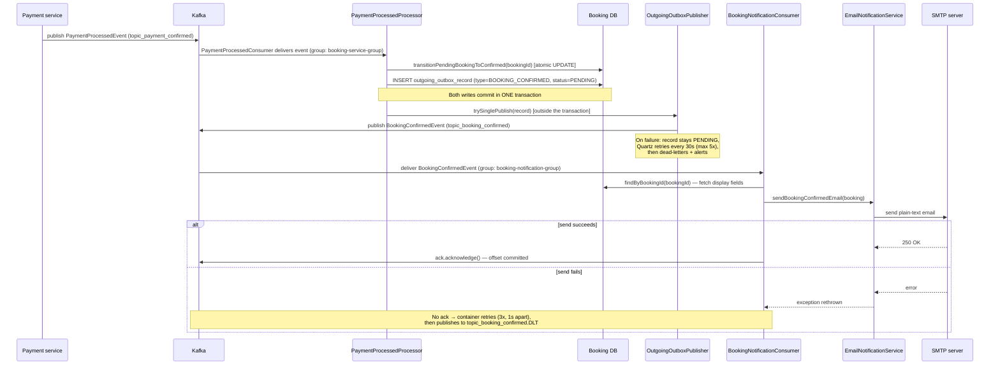

# Booking-confirmed email notifications

## WHAT

When a booking transitions from `PENDING` to `CONFIRMED` (i.e. payment succeeded),
the Booking service sends the customer a "your booking is confirmed" email —
asynchronously, without slowing down or risking the payment-confirmation request
itself.

> **Naming note**: `BookingStatus` has no `COMPLETED` value today (only
> `PENDING / CONFIRMED / FAILED / CANCELLED`). This feature fires on **`CONFIRMED`**.
> If a separate "service delivered" status is introduced later (e.g. once the
> vendor-task-completion flow exists), this doc and the consumer below are the
> only places that need to change.

## WHY this design

| Decision | Alternatives considered | Why this one |
|---|---|---|
| Kafka consumer, not `@Async`/`@EventListener` | In-process async method call | The booking-confirmed fact already becomes a durable Kafka event (`topic_booking_confirmed`) via the existing outbox. Reusing it means the email survives an app restart between "status updated" and "email sent" — an in-process async call would be lost on crash. |
| **Self-consumption inside Booking service**, not a new microservice or a Platform-side consumer | New "notification service"; consumer added to Platform/Core | Booking already owns 100% of the data needed for the email body (experience name, booking date, guest count) and already has the retry/DLQ container infrastructure. No new service, no new cross-service data fetch. |
| Separate consumer group (`booking-notification-group`) | Reuse `booking-service-group` | An independent group gets its own offsets. A slow/broken mail server cannot block or delay the `booking-service-group` consumers that process booking/payment state transitions — the two concerns fail independently. |
| Ack-on-success only (simple retry), not the inbound-outbox/idempotency pattern used elsewhere | Mirror `InboundEventProcessorService`'s ack-immediately + DB-tracked retry pattern | Booking/payment state transitions must be exactly-once (double-processing = real bugs). A duplicate confirmation email on redelivery is a minor UX nit, not a correctness issue, so the extra idempotency bookkeeping wasn't worth it here. |

## Components

| File | Role |
|---|---|
| `service/inbound/PaymentProcessedProcessor.java` | On `PAYMENT_PROCESSED`, atomically flips booking `PENDING→CONFIRMED` and writes a `BookingConfirmedEvent` to the **outgoing** outbox (same DB transaction). |
| `service/retries_cleanup/OutgoingOutboxPublisher.java` | Publishes the outbox record to Kafka: immediately after commit, then every 30 seconds via Quartz (`QuartzConfig.outgoingOutboxPublisherTrigger`) if the immediate attempt failed (up to 5 retries, then dead-lettered + alerted). Note: the class's own Javadoc says "every minute" — that comment is stale; the actual trigger is 30s. |
| `config/BookingKafkaConfig.java` | Declares the `topic_booking_confirmed` topic, the shared `kafkaListenerContainerFactory` (manual ack, 3 retries/1s, then DLT), and now a consumer-side type mapping so Booking can deserialize **its own** `BookingConfirmedEvent` back from that topic. |
| `consumer/BookingNotificationConsumer.java` **(new)** | Subscribes to `topic_booking_confirmed` as group `booking-notification-group`. Re-fetches the full `Booking` row and calls the email service. Acks only on success. |
| `service/notification/EmailNotificationService.java` **(new)** | Builds and sends the plain-text email via Spring `JavaMailSender`. |
| `src/main/resources/application.yml` | `spring.mail.*` (SMTP connection) and `app.mail.from` (sender address) — currently placeholders. |

## End-to-end flow



### Step by step

1. **Trigger**: Payment service confirms payment and publishes `PaymentProcessedEvent`
   to `topic_payment_confirmed`.
2. **Status flip**: Booking's `PaymentProcessedConsumer` → `InboundEventProcessorService`
   → `PaymentProcessedProcessor` flips the booking to `CONFIRMED` and, in the same
   DB transaction, writes an outgoing-outbox row carrying a `BookingConfirmedEvent`
   (`bookingId, userId, userEmail, experienceId, timeSlotMapperId, guestCount,
   confirmedAt` — built by `OutboundEventGenerator`).
3. **Publish**: Right after that transaction commits, `OutgoingOutboxPublisher`
   attempts an immediate Kafka publish to `topic_booking_confirmed`, keyed by
   `bookingId`. If Kafka is unavailable at that instant, the record simply stays
   `PENDING` and a Quartz job (`QuartzConfig.outgoingOutboxPublisherTrigger`,
   every 30 seconds) retries it (up to 5 attempts) before dead-lettering +
   alerting — the email is never silently lost because the state update
   already committed.
4. **Self-consumption**: `BookingNotificationConsumer` (its own consumer group,
   so it can't block or be blocked by `booking-service-group`) receives the event.
5. **Enrichment**: the consumer re-fetches the full `Booking` row by `bookingId`,
   because the event itself only carries IDs — not `experienceName`,
   `userFullName`, or `bookingDate`, which the email needs.
6. **Send**: `EmailNotificationService` builds a `SimpleMailMessage` (from
   `app.mail.from`, to `booking.userEmail`) and sends it through `JavaMailSender`.
7. **Acknowledge**: only on a successful send does the consumer call
   `ack.acknowledge()`. Any exception (booking row missing, SMTP error, etc.)
   propagates un-acked.

## Failure handling

| Failure point | What happens | Where to look |
|---|---|---|
| Kafka down when the state-transition commits | Outbox row stays `PENDING`; Quartz retries every 30s, up to 5 attempts | `outgoing_outbox_record` table, status column |
| All 5 outbox retries exhausted | Record marked dead, `AlertService` logs a 🔔 alert, a `BOOKING_FAILED` compensation event is queued | `OutgoingOutboxDeadLetterHandler` logs |
| Booking row not found when the notification consumer looks it up | Consumer throws, does not ack → redelivered | `BookingNotificationConsumer` logs an ERROR with the bookingId |
| SMTP send fails (bad creds, timeout, etc.) | Consumer throws, does not ack → redelivered | `EmailNotificationService` logs an ERROR with the exception |
| Redelivery fails 3x (1s backoff) | Record published to `topic_booking_confirmed.DLT` and the offset is committed — **no further retries, no alert** | Dead-letter topic (consume it manually to inspect) |
| `userEmail` is null/blank on the booking | Logged as a WARN and skipped — **this counts as "handled"**, no retry, since retrying can't fix missing data | `EmailNotificationService` logs a WARN |

> **Gap to be aware of**: unlike the outbox dead-letter path, a permanently
> failing notification (e.g. wrong SMTP password) lands in
> `topic_booking_confirmed.DLT` with **no alerting today** — see
> [Future improvements](#future-improvements).

## Configuration reference

All values below are **placeholders** — the feature is fully wired but will not
send real email until these are set to real values (any SMTP-compatible
provider works: Gmail app password, Amazon SES SMTP, SendGrid SMTP relay,
Mailtrap for a dev sandbox, etc.):

```yaml
spring:
  mail:
    host: ${SMTP_HOST:smtp.example.com}
    port: ${SMTP_PORT:587}
    username: ${SMTP_USERNAME:placeholder-username}
    password: ${SMTP_PASSWORD:placeholder-password}
app:
  mail:
    from: ${MAIL_FROM_ADDRESS:no-reply@momentforever.example.com}
```

| Env var | Purpose |
|---|---|
| `SMTP_HOST` / `SMTP_PORT` | SMTP server address |
| `SMTP_USERNAME` / `SMTP_PASSWORD` | SMTP auth credentials |
| `MAIL_FROM_ADDRESS` | "From" address shown to the customer — needs a real, deliverable domain |

## How to verify

1. **Unit/integration**: run `mvnw test` — the Spring context boot confirms both
   `booking-service-group` and `booking-notification-group` listener containers
   start cleanly (visible in test logs as
   `groupId=booking-notification-group`).
2. **Local end-to-end**:
   - Point `spring.mail.*` at a sandbox SMTP (e.g. Mailtrap) via env vars.
   - Drive a booking through `PENDING → CONFIRMED` (publish/consume a
     `PaymentProcessedEvent`, or call the existing test fixtures that do this).
   - Confirm in logs: `Booking confirmation outbox created` →
     `Immediate publish succeeded` → `Booking-confirmed email sent`.
   - Confirm the email arrives in the sandbox inbox.
3. **Failure path**: temporarily point `SMTP_HOST` at an unreachable host and
   confirm the consumer logs 3 retry attempts then the record appears on
   `topic_booking_confirmed.DLT` (e.g. via `kafka-console-consumer` on that
   topic).

## Future improvements

- **Alert on notification DLQ**: wire `AlertService` (or similar) to the
  `topic_booking_confirmed.DLT` topic so a permanently-failing email doesn't
  go unnoticed.
- **HTML template + branding** instead of `SimpleMailMessage` plain text
  (e.g. Thymeleaf + `MimeMessage`).
- **Cancellation email**: `cancelBooking()` does not currently publish any
  outbound event, so there is no equivalent trigger for a "booking cancelled"
  email yet — would need a `BOOKING_CANCELLED` outbox/topic first.
- **User notification preferences** (opt out, SMS/push in addition to email).
- **Templated subject/body localization (i18n)** if the customer base expands
  beyond one language.
- **Re-point to a real "completed" status** once the vendor-task-completion
  flow (see `docs/vendor-app` design, if present) introduces one — see the
  naming note at the top of this document.

## Quick reference

| Item | Value |
|---|---|
| Kafka topic | `topic_booking_confirmed` (`kafka.topics.booking-confirmed`) |
| Consumer group | `booking-notification-group` |
| Container factory | `kafkaListenerContainerFactory` (manual ack, 3 retries/1s, then DLT) |
| Trigger status transition | `PENDING → CONFIRMED` |
| Event class (wire) | `com.forvmom.MomentForeverBooking.events.BookingConfirmedEvent` |
| Email sender | `EmailNotificationService` (`JavaMailSender` + `SimpleMailMessage`) |
