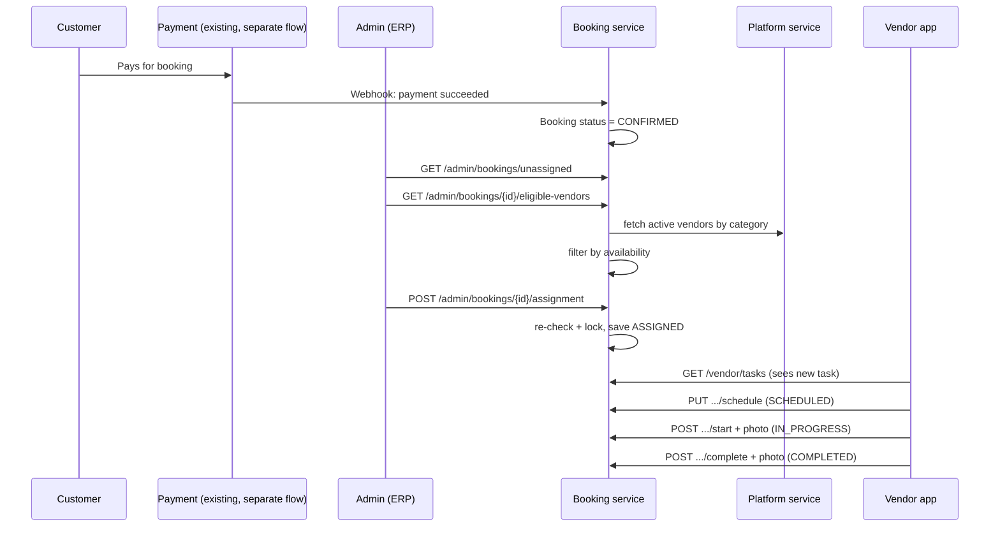

# 09 — End-to-End Flow (Plain English)

[← Back to index](./README.md)

This file has no new technical decisions in it — everything here is explained in detail in files 02–08. This is the "tell me the story first" version, written for someone picking this feature up for the first time. Read this first, then go to the specific file linked at each step for the actual contract.

## The cast of characters

- **Customer** — books an experience on the website and pays for it. Already fully built; not part of this feature.
- **Admin** — uses the internal ERP tool to assign bookings to vendors.
- **Vendor** — the person/business who actually shows up and does the work (decoration, setup, etc.), using the vendor app.
- **Booking service** — where almost everything in this document actually lives.
- **Platform service** — owns login and the vendor's profile (name, category, active/inactive), but not the task itself.

## Phase 0 — Before this feature even starts: the booking is already paid for

A customer picks an experience, a session is created with the payment provider (Stripe/Razorpay), they pay, a webhook tells the Booking service the payment succeeded, and the booking's status becomes `CONFIRMED`. This is a completely separate, already-working flow — covered earlier in this project's payment-flow discussion, not in this document. **The only thing this feature cares about is: a booking exists and its status is `CONFIRMED`.** Nothing below happens before that's true.

## Phase 1 — The booking shows up on the admin's "needs a vendor" list

Every `CONFIRMED` booking that doesn't have a vendor yet shows up when the admin opens the ERP tool, via `GET /admin/bookings/unassigned` ([03-api-reference.md](./03-api-reference.md) A1). Nothing vendor-related has happened yet — this is just a worklist.

## Phase 2 — The admin picks a vendor

The admin clicks on a booking, and the ERP tool calls `GET /admin/bookings/{bookingId}/eligible-vendors` (A2). Behind the scenes, this does two things: it asks the Platform service "who are the active vendors in the right category," and then it checks, inside Booking's own data, which of those vendors are actually **free** at the booking's date/time (nobody already has an overlapping job booked). Only vendors passing both checks come back. The admin picks one and clicks "Assign," which calls `POST /admin/bookings/{bookingId}/assignment` (A3).

At this exact moment, the system double-checks everything one more time (the vendor could have been grabbed by someone else a second ago) before actually saving the assignment — this is the only place real locking happens, explained fully in [06-concurrency.md](./06-concurrency.md). If everything's still fine, a new row is created: this booking now belongs to this vendor, with status `ASSIGNED`.

## Phase 3 — The vendor sees the task appear

The vendor app calls `GET /vendor/tasks` (B1) — the vendor only ever sees bookings assigned to *them*, because the backend reads *who's calling* from the request itself (not from anything the app sends that could be faked) and filters by that. The customer's payment amount is never part of this response — the vendor only sees what they need to actually do the job (where, when, for how many guests, which add-ons).

## Phase 4 — The vendor commits to a time

The vendor picks a date/time and calls `PUT /vendor/tasks/{bookingId}/schedule` (B4). Status moves `ASSIGNED → SCHEDULED`. (This step can be skipped straight to Phase 5 if the business doesn't need an explicit scheduling step — it's there because "mark scheduled" was specifically requested.)

## Phase 5 — The vendor starts the work

On the day, the vendor opens the task and taps "Start." The app takes a photo on the spot and sends it together with the status change in one request, `POST /vendor/tasks/{bookingId}/start` (B5). The server stores the photo, stamps it with the server's own clock (not the vendor's phone clock — see [08-challenges-ui-must-handle.md](./08-challenges-ui-must-handle.md) #11), and moves status to `IN_PROGRESS`. It's deliberately **impossible** to end up `IN_PROGRESS` without a photo — the photo and the status change are the same API call, not two separate steps that could get out of sync.

## Phase 6 — The vendor finishes the work

Same shape as the previous step: a completion photo plus the status change in one call, `POST /vendor/tasks/{bookingId}/complete` (B6). Status moves `IN_PROGRESS → COMPLETED`, which is a dead end — nothing can change a `COMPLETED` task's status afterward (reassignment is blocked too, see [03-api-reference.md](./03-api-reference.md) A4).

## Phase 7 — If something goes wrong instead

Either side can cancel, always with a reason:
- **Admin** cancels the assignment (`DELETE /admin/bookings/{bookingId}/assignment`, A5) — e.g. the customer asked for a different vendor.
- **Vendor** cancels their own task (`PUT /vendor/tasks/{bookingId}/cancel`, B7) — e.g. they genuinely can't make it.

Either way, the reason is required and saved, status becomes `CANCELLED` (also a dead end), and the admin can assign a different vendor afterward the same way as Phase 2.

## Phase 8 — Anyone can ask "what actually happened here"

Every single change above — assigned, scheduled, started, completed, cancelled, reassigned — writes one line to a permanent history log (`booking_vendor_events`) that's never edited or deleted. `GET /admin/bookings/{bookingId}/assignment/events` (A7) shows this full timeline. This exists specifically so that six months from now, when someone asks "why does this booking show as cancelled," there's a real answer instead of a guess.

## The whole thing, as one picture

## Where to go next

- Building the database/entities? → [02-data-model.md](./02-data-model.md)
- Building an endpoint? → [03-api-reference.md](./03-api-reference.md)
- Wondering if something was missed? → [04-gap-list.md](./04-gap-list.md)
- Writing error responses? → [05-error-handling.md](./05-error-handling.md)
- Worried about two things happening at once? → [06-concurrency.md](./06-concurrency.md)
- Deciding what to build later, not now? → [07-future-improvements.md](./07-future-improvements.md)
- Building the actual screens? → [08-challenges-ui-must-handle.md](./08-challenges-ui-must-handle.md) and [ui-handover.md](./ui-handover.md)

---

[← Back to index](./README.md)

